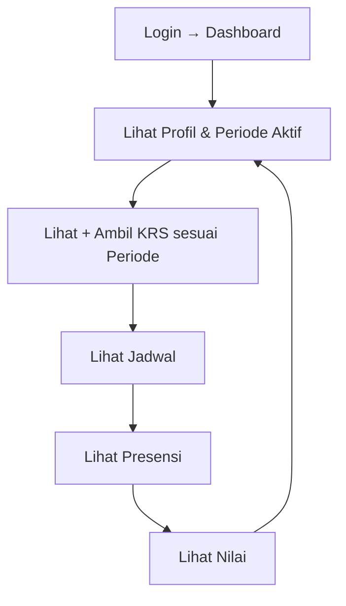

# Master Plan — Fitur Role Mahasiswa (Sistem Informasi Akademik)

> Acuan kanonis: [Rencana.md](./Rencana.md). [ARCHITECTURE.md](./ARCHITECTURE.md) dan [ERD.md](./ERD.md) dipakai hanya untuk detail teknis yang tidak diatur Rencana. Setiap modul di bawah mencantumkan sumber pasalnya; yang berlabel EKSTENSI berada di luar Rencana dan tidak boleh dianggap kontrak MVP.

---

## 0. Traceability ke Rencana.md

| Acuan Rencana | Isi | Dampak ke spek ini |
|:---|:---|:---|
| §12 Role-Based Access Control | Mahasiswa dapat: melihat profil, melihat KRS, mengambil KRS sesuai periode, melihat jadwal, melihat nilai, melihat presensi, melihat informasi akademik | 7 kemampuan ini = satu-satunya kontrak P0. Tidak ada transkrip, surat, yudisium, bimbingan di §12 |
| §19 Routing | `/mahasiswa`, `/mahasiswa/krs`, `/mahasiswa/jadwal`, `/mahasiswa/nilai` | Route kanonis hanya 3 sub-route. `/mahasiswa/presensi` + `/mahasiswa/profil` berasal dari ARCHITECTURE (diterima sebagai pelengkap). Sisanya (`dashboard`, `transkrip`, `bimbingan`, `surat`, `yudisium`) = EKSTENSI |
| §16 Flutter Architecture | Fitur top-level: `auth`, `dashboard`, `mahasiswa`, `krs`, `jadwal`, `nilai`, `presensi`, `profile` | `dashboard` dan `profile` adalah fitur lintas-role, BUKAN sub-folder `/mahasiswa`. `krs/jadwal/nilai/presensi` adalah fitur domain yang dipakai mahasiswa |
| §17 Backend services | `auth_service`, `krs_service`, `nilai_service`, `jadwal_service`, `presensi_service` | Tidak ada service transkrip/surat/yudisium/bimbingan/kalender di kontrak backend |
| §15 Audit Log | Kode mahasiswa satu-satunya: `STUDENT_SUBMITTED_KRS` | Kode `MAHASISWA_BATALKAN_KRS`, `MAHASISWA_KONSULTASI`, `MAHASISWA_UBAH_PROFIL` = usulan, bukan kanonis |
| §27 Workflows | Login→Dashboard, lihat KRS, lihat nilai | Tidak ada flow transkrip/surat/yudisium untuk mahasiswa |
| §14 Auth | Email/Username + Password via Supabase; session Access + Refresh Token | Semua modul mengasumsikan flow ini |
| §18 + §32 | State: Riverpod. Networking web: Dio/HTTP ke Dart server lokal | Pola wajib semua modul |
| §4 Breakpoints | `<600` mobile, `600–1023` tablet, `>=1024` desktop | Pola wajib semua modul |
| §28 Prinsip | UI tanpa business logic berat; akses via Repository/Service; RLS final di Supabase | Pola wajib semua modul |

---

## 1. Gambaran Umum (sesuai §12)

Mahasiswa = role read-own + ajukan. 7 kemampuan kanonis:

1. Melihat profil.
2. Melihat KRS.
3. Mengambil KRS sesuai periode.
4. Melihat jadwal.
5. Melihat nilai.
6. Melihat presensi.
7. Melihat informasi akademik (periode aktif + pengumuman, read-only).

Di luar 7 ini (transkrip, bimbingan/PA approval, surat QR, yudisium, matriks SKS-IPS, aturan 75%, 144 SKS) = EKSTENSI dari `Admin.md`/`ERD.md`, ditandai eksplisit di §3.

---

## 2. Lifecycle (sesuai §27, tanpa tambahan flow)



> Tidak ada tahap konsultasi wajib, surat, atau yudisium di Rencana §27. Itu alur Admin.

---

## 3. Matriks Fitur

### 3a. Kanonis Rencana.md (P0 MVP)

| No | Modul | Kemampuan §12 | Route (§19 + ARCHITECTURE) | Fitur folder (§16) | Service (§17) | File spek |
|:--:|:---|:---|:---|:---|:---|:---|
| 01 | Profil | melihat profil | `/mahasiswa/profil` (ARCHITECTURE) | `profile/` + `mahasiswa/` | `auth_service` (sesi §14) | `02_profil_dan_status.md` |
| 02 | KRS | melihat + mengambil KRS sesuai periode | `/mahasiswa/krs` (§19) | `krs/` + `mahasiswa/` | `krs_service` | `03_krs.md` |
| 03 | Jadwal | melihat jadwal | `/mahasiswa/jadwal` (§19) | `jadwal/` + `mahasiswa/` | `jadwal_service` | `04_jadwal_kuliah.md` |
| 04 | Nilai | melihat nilai | `/mahasiswa/nilai` (§19) | `nilai/` + `mahasiswa/` | `nilai_service` | `05_nilai_dan_khs.md` |
| 05 | Presensi | melihat presensi | `/mahasiswa/presensi` (ARCHITECTURE) | `presensi/` + `mahasiswa/` | `presensi_service` | `06_presensi_saya.md` |
| 06 | Info akademik | melihat informasi akademik | bagian dari `/mahasiswa` (induk §19) + `dashboard/` (§16, lintas-role) | `dashboard/` | — (agregat read-only) | `01_dashboard.md` + `09_kalender_dan_pengumuman.md` (dipangkas, lihat catatan) |

Catatan koreksi terhadap spek lama:
- `01_dashboard.md`: dashboard adalah fitur lintas-role (§16), bukan route `/mahasiswa/dashboard`. Layar mahasiswa = agregat read-only dari 5 service kanonis.
- `09_kalender_dan_pengumuman.md`: dipangkas menjadi "Info akademik read-only" (periode aktif + pengumuman). Countdown KRS/UTS/UAS dan jendela KPRS = EKSTENSI, bukan §12.
- Status `DRAFT → MENUNGGU_APPROVAL → AKTIF` dan `catatan_pa` di spek lama = EKSTENSI dari modul admin. Rencana §12 hanya menyebut "mengambil KRS sesuai periode" tanpa approval PA.

### 3b. EKSTENSI di luar Rencana.md (bukan kontrak MVP)

| Modul | Sumber sebenarnya | Status |
|:---|:---|:---|
| Matriks plafon SKS berbasis IPS (24/21/18/15/12, maba paket 20) | `fitur_admin/07` | EKSTENSI, bukan Rencana. Boleh dipakai sebagai aturan validasi dengan label jelas |
| Approval Dosen Wali + `disetujui_oleh_pa` + `catatan_pa` | `fitur_admin/07, 11` | EKSTENSI. Rencana tidak mengatur approval untuk mahasiswa |
| Warning presensi 75% / 85% | `Admin.md` / modul admin 09 | EKSTENSI. Rencana §12 hanya "melihat presensi" |
| Transkrip + progress kurikulum 1-8 (`07`) | — (tidak ada di Rencana) | EKSTENSI P1 |
| Bimbingan/konsultasi (`08`) | — | EKSTENSI P1 |
| Surat akademik + QR (`10`) | — (tabel belum ada di ERD v1) | EKSTENSI P2 |
| Yudisium 144 SKS/IPK≥2.0 (`11`) | modul admin 12 | EKSTENSI P2 |
| Layanan pengajuan: cuti, banding nilai, konversi/MBKM (`12`) | modul admin 08/12/14 (sisi admin); §12 Rencana tidak mengatur sisi mahasiswa | EKSTENSI P2, butuh migration baru (§8) |

### 3c. Turunan & Penegakan Aturan (memperkaya §3a, bukan kapabilitas baru)

| No | Modul | Memperkaya | Skema | File spek |
|:--:|:---|:---|:---|:---|
| 13 | Kalkulator Target IPK | "melihat nilai" (§12) | Tanpa tabel | `13_kalkulator_ipk.md` |
| 14 | Rekomendasi Kelas | "mengambil KRS sesuai periode" (§12) | Tanpa tabel | `14_rekomendasi_kelas.md` |
| 15 | Prasyarat Mata Kuliah | Validasi `03` | **Migration `022`** (`mata_kuliah_prasyarat`) | `15_prasyarat_mata_kuliah.md` |

> Ketiganya tidak menambah kemampuan role di luar §12: `13` hanya menghitung ulang data nilai sendiri, `14` hanya menyusun ulang katalog, `15` hanya menolak KRS yang tidak sah. Prioritas implementasi: setelah P0 §3a stabil.

---

## 4. Routing Final (selaras §19 + ARCHITECTURE)

Kanonis (wajib):

```
/login                                    (§19, flow §14 + §27)
/mahasiswa                                (§19, induk role)
/mahasiswa/krs                            (§19)
/mahasiswa/jadwal                         (§19)
/mahasiswa/nilai                          (§19)
/mahasiswa/presensi                       (ARCHITECTURE pelengkap §12)
/mahasiswa/profil                         (ARCHITECTURE pelengkap §12)

Turunan (tetap di dalam route kanonis, bukan route baru):
/mahasiswa/nilai/simulasi-ipk             (spek `13`, panel dalam Nilai)
/mahasiswa/krs/rekomendasi                (spek `14`, panel dalam KRS)
```

EKSTENSI (dilarang diklaim sebagai kontrak Rencana; implementasi hanya setelah P0):

```
/mahasiswa/transkrip, /mahasiswa/bimbingan, /mahasiswa/surat, /mahasiswa/yudisium,
/mahasiswa/pengajuan (cuti, banding nilai, konversi — spek `12_layanan_pengajuan.md`)
```

> Route guard GoRouter hanya kontrol navigasi. Otorisasi final di RLS Supabase (§28.4, ARCHITECTURE).

---

## 5. Kontrak Backend & Audit (selaras §17 + §15)

- Service kanonis: `auth_service`, `krs_service`, `nilai_service`, `jadwal_service`, `presensi_service` (`packages/sia_backend_core`). Tidak ada service lain di MVP.
- Audit kanonis untuk mahasiswa: `STUDENT_SUBMITTED_KRS` (§15) dengan field minimal `id, user_id, action, entity, entity_id, metadata, created_at` (§15).
- Kode audit lain (`MAHASISWA_BATALKAN_KRS`, `MAHASISWA_KONSULTASI`, `MAHASISWA_UBAH_PROFIL`) = usulan, ditandai di file spek masing-masing.

---

## 6. Pola Implementasi Wajib (§16, §18, §28, §32)

- Struktur: `Page → Controller/Provider (Riverpod) → Repository → Backend Isolate / Dart Server → Supabase` (§16, §18).
- Tidak ada query Supabase langsung dari widget; tidak ada business logic berat di UI (§28.2–28.3).
- Web dev: Flutter Web → Dio/HTTP → `dart_frog` localhost (§32). Mobile/desktop: Isolate in-process (§20).
- Breakpoints §4: `<600` mobile, `600–1023` tablet, `>=1024` desktop.
- Auth: Supabase Auth, Access + Refresh Token, tanpa password plaintext (§14).
- Kredensial privileged (Postgres password, service key) dilarang di APK/installer (Tujuan Arsitektur §2.8, §29).

---

## 7. Cakupan MVP (P0 = §3a saja)

6 modul kanonis (profil, KRS, jadwal, nilai, presensi, info akademik), 6 route kanonis, 5 service kanonis. Bukti selesai: login → lihat profil → ambil KRS sesuai periode → lihat jadwal/nilai/presensi end-to-end (workflows §27). Ekstensi P1/P2 dikerjakan setelah itu dan tidak boleh mengubah kontrak kanonis.

---

## 8. Backlog Kelengkapan Non-MVP (di luar 12 file spek)

Item di bawah ini dibutuhkan agar fitur "lengkap" tetapi **terblokir keputusan produk/data** — didokumentasikan di sini, bukan dispekulasi sebagai modul:

| Item | Status | Alasan |
|:---|:---|:---|
| Tagihan & pembayaran UKT/SPP + gate KRS | TERBLOKIR | `fitur_admin/07` menyebut verifikasi flag keuangan sebelum KRS, tetapi tidak ada tabel keuangan di ERD v1. Butuh keputusan produk + migration |
| Jadwal ujian (UTS/UAS) per MK | TERBLOKIR | Tidak ada tabel jadwal ujian di ERD v1 (`jadwal_kelas` hanya jadwal reguler mingguan) |
| Ganti password | Milik fitur `auth/` (§16), bukan `mahasiswa/` | Cross-ref: flow §14; tidak diduplikasi di spek mahasiswa |
| Notifikasi push (deadline KRS, hasil banding, pengumuman) | Backlog teknis | Membutuhkan keputusan channel (FCM vs polling) di luar Rencana |
